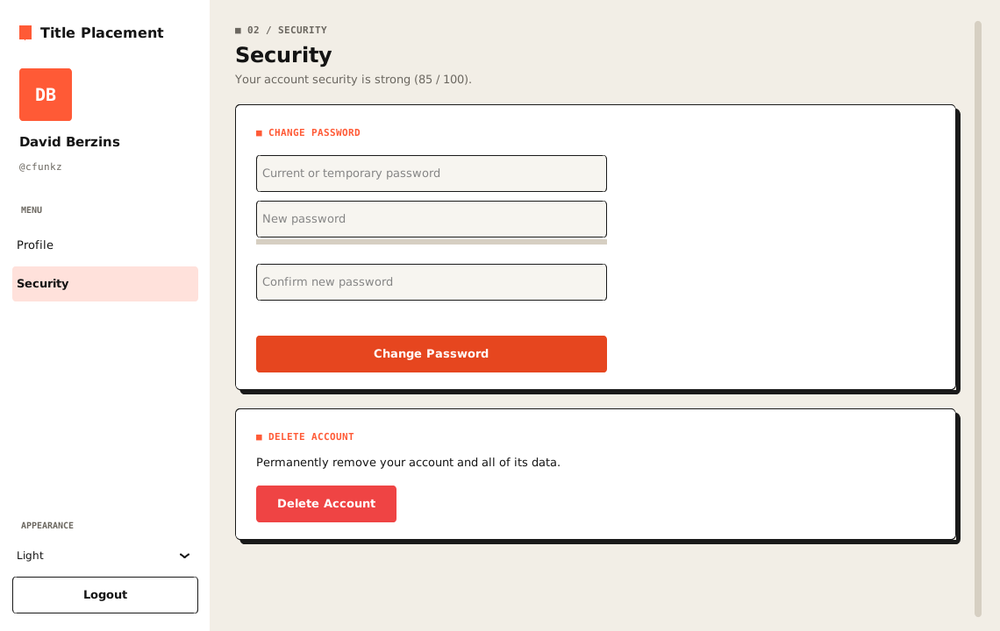

  


# CustomTkinter-Login-Registration

Registration and login app made using customtkinter with input validation, hashed passwords and Google, Facebook and Discord login.

This includes a sqlite3 database setup with many functions including saving the registration data, logging in with username or email, OAuth login, password reset by email, security questions, country selection, light and dark mode, a profile page, password change, account deletion, and more. Settings can be changed in `config.py` or in a `.env` file.

## Table of Contents

- [Screenshots](#screenshots)
- [Prerequisites](#prerequisites)
- [Features](#features)
- [Security](#security)
- [Database Security](#database-security)
- [Project Structure](#project-structure)
- [Installation](#installation)
- [Release Builds (Windows, macOS, Linux)](#release-builds-windows-macos-linux)
- [Tests](#tests)
- [Database Location](#database-location)
- [PostgreSQL and MySQL](#postgresql-and-mysql)
- [Configuration](#configuration)
- [OAuth Setup](#oauth-setup)
- [User Database Functions](#user-database-functions)
- [OAuth Functions](#oauth-functions)
- [Validation Functions](#validation-functions)
- [UI Functions](#ui-functions)
- [Upgrading From an Older Version](#upgrading-from-an-older-version)
- [Contributing](#contributing)

## Screenshots


<p>
  
  
</p>



## Prerequisites

Before you begin, ensure you have met the following requirements:

- `Python 3.9+` with `tkinter`: tkinter ships with Python on Windows and macOS. On Linux install it with `sudo apt install python3-tk`.
- `customtkinter`: You can install customtkinter using `pip install customtkinter`.
- `pycountry`: You can install pycountry using `pip install pycountry`.
- `Pillow`: You can install Pillow using `pip install Pillow`.

OAuth sign-in uses only the Python standard library, no extra packages are needed.

Optional, only for other databases:

- `psycopg2-binary` for PostgreSQL: `pip install psycopg2-binary`
- `PyMySQL` for MySQL / MariaDB: `pip install PyMySQL`

## Features

- Login with username or email.
- Google, Facebook and Discord login (OAuth 2.0).
- Registration with password confirmation and password strength bar.
- Forgot password: email, security question, temporary password sent by email.
- New password required after logging in with a temporary password.
- Profile page with a hero banner, stat tiles (member for, logins, profile complete, security score), an "About me" bio, a profile strength checklist, account details and editable name and country.
- Export your profile as a JSON file.
- Security page: change or set password, delete account.
- Light and dark mode with a frosted glass look and rounded cards.
- Settings in `config.py` or `.env`.
- SQLite by default, PostgreSQL or MySQL with one setting.
- Builds for Windows (`.exe`), macOS (`.app`) and Linux, tested and built by GitHub Actions.
- Older databases are upgraded automatically.

## Security

- Passwords and security answers are hashed with PBKDF2-SHA256 and a random salt.
- Account is locked for 5 minutes after 5 wrong passwords.
- 3 wrong security answers send the user back to the login screen.
- Temporary passwords are made with `secrets` and only saved if the email was sent.
- OAuth uses a random `state` check, PKCE for Google and a local redirect server that closes after a timeout.
- A social login is only linked to an existing account if the provider says the email is verified.
- SMTP and OAuth secrets are kept in `.env`, which is ignored by git.
- All queries use `?` parameters.

## Database Security

The SQLite database is **not encrypted**. It is a normal file that can be opened with any SQLite tool, such as [DB Browser for SQLite](https://sqlitebrowser.org/).

### Who can open it
- On Windows the file is in `%APPDATA%\TitlePlacement`, which only the Windows user who owns it and administrators can open by default.
- Other standard Windows users on the same PC can't open it.
- Anyone logged in as that Windows user, an administrator, or anyone with the file copied from the disk can read and edit it.

### What they can see
- Usernames, emails, names, countries, security questions, sign-in providers and login times are stored as plain text.
- Passwords and security answers are hashed with PBKDF2, so they can't be read back. Guessing them takes a long time for strong passwords.

### What they can change
- Any row: delete users, change names or emails, clear a lockout.
- A password hash: replacing it with the hash of a password they know lets them log in as that user.
- The app has no way to detect these changes.

### Why encrypting the file doesn't fully fix it
- A desktop app has to open the database by itself, so the encryption key would have to be inside the `.exe` or `.env`, where it can be found.
- Encryption (for example SQLCipher) stops someone who only has a copy of the file, but not someone who also has the app.

### Safer options
- Keep SQLite for a single user on their own PC, where the user owns their own data.
- Use PostgreSQL or MySQL on a server so the database file is not on the user's PC. Give the app a database user with only the rights it needs (`SELECT`, `INSERT`, `UPDATE`, `DELETE` on `Users`).
- The PostgreSQL / MySQL password is in `.env` next to the app, so anyone with the app can still connect. For real multi-user security, put a server API between the app and the database, so users never get database credentials.
- Turn on Windows BitLocker to protect the disk if the PC is lost or stolen.

## Project Structure

```
main.py           # Start the app
app.py            # MainApp window, switches between frames
frames.py         # All screens and UI helper functions
functions.py      # User, security, email and validation functions
database.py       # Database connection for SQLite, PostgreSQL and MySQL
oauth.py          # Google, Facebook and Discord sign-in (OAuth 2.0)
config.py         # Every setting, reads .env for values you change
.env.example      # Template for your .env file
requirements.txt  # Python packages
build.py          # Builds the app with PyInstaller (.exe, .app or Linux binary)
build.bat         # Windows: double-click to build the .exe
tests/            # Unit tests and a UI test that opens every screen
.github/workflows # GitHub Actions: test and build on Windows, macOS and Linux
images/           # Login button logos and screenshots
```

## Installation

To install CustomTkinter-Login-Registration, follow these steps:

1. Clone this repository:

   ```bash
   git clone https://github.com/cfunkz/CustomTkinter-Login-Registration.git
   cd CustomTkinter-Login-Registration
   ```

2. Install Imports:

   ```bash
   pip install -r requirements.txt
   ```

3. Create your settings file (optional, only needed for email and OAuth login):

   ```bash
   cp .env.example .env
   ```

4. Run the app:

   ```bash
   python main.py
   ```

## Release Builds (Windows, macOS, Linux)

The app can be built into a single app that runs without Python installed.

| System | Command | Result |
| --- | --- | --- |
| Windows | Double-click `build.bat` or run `python build.py` | `dist\TitlePlacement.exe` |
| macOS | `python3 build.py` | `dist/TitlePlacement.app` |
| Linux | `python3 build.py` | `dist/TitlePlacement` |

Install the packages first with `pip install -r requirements.txt pyinstaller`. `build.py` uses PyInstaller and bundles the images, customtkinter themes, country list and the PostgreSQL / MySQL driver if it is installed. Add `images/icon.ico` to give the app an icon. PyInstaller builds for the system it runs on, so each system is built on its own.

GitHub Actions does this for you: [`.github/workflows/build.yml`](.github/workflows/build.yml) runs the tests and builds all three on every push and pull request. Download them from the run's **Artifacts**. Push a version tag to publish a release with all three files attached:

```bash
git tag v1.0.0
git push origin v1.0.0
```

Notes:

- macOS: the app is not signed, so the first time right-click it and choose **Open**.
- Linux: the binary needs Tk, which most desktops have. If not, install it with `sudo apt install libtk8.6` (or your distro's `tk` package). Run `chmod +x TitlePlacement` after downloading.

To configure the app, put a `.env` file next to it or in the data folder below.

## Tests

```bash
python -m unittest discover -s tests -t . -v
```

The tests use a temporary database. `tests/test_ui.py` opens the real window and goes through every screen, it is skipped when there is no display. On a Linux server run it with `xvfb-run -a python -m unittest discover -s tests -t . -v`.

## Database Location

The SQLite database is saved in one fixed folder per user, so it is the same no matter where the app or `.exe` is started from:

| System | Folder |
| --- | --- |
| Windows | `%APPDATA%\TitlePlacement\user_database.db` |
| macOS | `~/Library/Application Support/TitlePlacement/user_database.db` |
| Linux | `~/.local/share/TitlePlacement/user_database.db` |

Change the folder name with `DATA_FOLDER`, or use another file with `DATABASE_FILE`.

## PostgreSQL and MySQL

SQLite is used by default. To use PostgreSQL or MySQL / MariaDB, install the driver and add the connection to `.env`. The `Users` table is created on first start.

PostgreSQL (`pip install psycopg2-binary`):

```bash
DATABASE_TYPE=postgres
DATABASE_HOST=localhost
DATABASE_PORT=5432
DATABASE_NAME=user_database
DATABASE_USER=app
DATABASE_PASSWORD=your-password
```

MySQL / MariaDB (`pip install PyMySQL`):

```bash
DATABASE_TYPE=mysql
DATABASE_HOST=localhost
DATABASE_PORT=3306
DATABASE_NAME=user_database
DATABASE_USER=app
DATABASE_PASSWORD=your-password
```

The database itself (`user_database`) must exist, the app only creates the table.

## Configuration

All settings live in `config.py`. Each value is read in this order:

1. Environment variables set in your terminal
2. The `.env` file next to `main.py` or the `.exe`
3. The `.env` file in the data folder (see [Database Location](#database-location))
4. The default value in `config.py`

Only add the values you want to change to `.env`. See `.env.example` for the full list.

| Variable | Default | Description |
| --- | --- | --- |
| `APP_NAME` | `Title Placement` | Name shown in the window title, above the forms and in the sidebar |
| `APPEARANCE_MODE` | `System` | `System`, `Light` or `Dark` |
| `COLOR_THEME` | `blue` | customtkinter theme: `blue`, `green`, `dark-blue` or a `.json` path |
| `ACCENT_COLOR` / `ACCENT_HOVER_COLOR` | `#6366F1` / `#4F46E5` | Buttons, links and highlights |
| `DANGER_COLOR` / `SUCCESS_COLOR` | `#EF4444` / `#22C55E` | Error and success colors |
| `FONT_FAMILY` | `Segoe UI` (Windows), `Helvetica Neue` (macOS), `DejaVu Sans` (Linux) | Font used everywhere |
| `UI_SCALING` | `1.0` | Scale all widgets |
| `AUTH_WINDOW_SIZE` | `560x720` | Login screens window size |
| `DASHBOARD_WINDOW_SIZE` | `1140x720` | Dashboard window size |
| `WINDOW_RESIZABLE` | `false` | Allow resizing the window |
| `BIO_MAX_LENGTH` | `160` | Longest "About me" text on the profile |
| `DATA_FOLDER` | `TitlePlacement` | Name of the data folder for the database and `.env` |
| `DATABASE_TYPE` | `sqlite` | `sqlite`, `postgres` or `mysql` |
| `DATABASE_FILE` | data folder `user_database.db` | SQLite database file |
| `DATABASE_HOST` / `DATABASE_PORT` | `localhost` / `5432` or `3306` | PostgreSQL / MySQL server |
| `DATABASE_NAME` | `user_database` | PostgreSQL / MySQL database name |
| `DATABASE_USER` / `DATABASE_PASSWORD` | — | PostgreSQL / MySQL login |
| `MIN_PASSWORD_LENGTH` | `8` | Minimum password length |
| `MAX_LOGIN_ATTEMPTS` | `5` | Wrong passwords before lockout |
| `LOCKOUT_MINUTES` | `5` | Lockout length |
| `MAX_SECURITY_ATTEMPTS` | `3` | Wrong security answers allowed |
| `HASH_ITERATIONS` | `310000` | PBKDF2 iterations for new hashes |
| `TEMPORARY_PASSWORD_LENGTH` | `12` | Length of emailed temporary passwords |
| `SMTP_SERVER` / `SMTP_PORT` | `smtp.gmail.com` / `587` | SMTP server (STARTTLS) |
| `SMTP_USERNAME` / `SMTP_PASSWORD` | — | Your Gmail address and [app password](https://myaccount.google.com/apppasswords) |
| `SMTP_TIMEOUT` | `15` | Seconds before an email attempt fails |
| `SENDER_EMAIL` | `SMTP_USERNAME` | The "From" address |
| `OAUTH_PROVIDERS` | `google,facebook,discord` | Social buttons shown, in this order |
| `OAUTH_REDIRECT_HOST` / `PORT` / `PATH` | `localhost` / `8765` / `/callback` | Local redirect URI |
| `OAUTH_TIMEOUT` | `120` | Seconds to wait for the browser sign-in |
| `OAUTH_LINK_BY_EMAIL` | `true` | Link a social sign-in to an existing account with the same verified email |
| `GOOGLE_CLIENT_ID` / `GOOGLE_CLIENT_SECRET` | — | Google OAuth client |
| `FACEBOOK_CLIENT_ID` / `FACEBOOK_CLIENT_SECRET` | — | Facebook app ID and secret |
| `FACEBOOK_API_VERSION` | `v19.0` | Facebook Graph API version |
| `DISCORD_CLIENT_ID` / `DISCORD_CLIENT_SECRET` | — | Discord application |

Example `.env`:

```bash
APP_NAME=Title Placement
APPEARANCE_MODE=Dark
SMTP_USERNAME=you@gmail.com
SMTP_PASSWORD=your-app-password
GOOGLE_CLIENT_ID=1234.apps.googleusercontent.com
GOOGLE_CLIENT_SECRET=your-secret
```

## OAuth Setup

The app opens the provider's login page in the browser and waits for it to redirect back to a small local server. Register this redirect URI with every provider:

```
http://localhost:8765/callback
```

If you change `OAUTH_REDIRECT_HOST`, `OAUTH_REDIRECT_PORT` or `OAUTH_REDIRECT_PATH`, register the new URI instead.

### Google
1. Open [Google Cloud Console > Credentials](https://console.cloud.google.com/apis/credentials).
2. Configure the OAuth consent screen, then create an **OAuth client ID** of type **Desktop app**.
3. Copy the client ID and secret to `GOOGLE_CLIENT_ID` and `GOOGLE_CLIENT_SECRET`.

### Facebook
1. Create an app at [Meta for Developers](https://developers.facebook.com/apps) and add the **Facebook Login** product.
2. Add `http://localhost:8765/callback` to **Valid OAuth Redirect URIs**.
3. Copy the App ID and App Secret to `FACEBOOK_CLIENT_ID` and `FACEBOOK_CLIENT_SECRET`.

### Discord
1. Create an application at the [Discord Developer Portal](https://discord.com/developers/applications).
2. Under **OAuth2 > Redirects** add `http://localhost:8765/callback`.
3. Copy the Client ID and Client Secret to `DISCORD_CLIENT_ID` and `DISCORD_CLIENT_SECRET`.

A provider without a client ID and secret still shows its button, and clicking it explains which values to add. Remove it from `OAUTH_PROVIDERS` to hide it.

## User Database Functions

The following functions are used for managing user data. The connection functions are in `database.py`, the rest are in `functions.py`.

### `get_database_connection()`
- Opens a SQLite, PostgreSQL or MySQL connection (from `DATABASE_TYPE`) and returns the connection and cursor.
- The cursor accepts `?` placeholders on every database.

### `close_database_connection(db)`
- Closes the provided database connection.

### `database()`
- Context manager that opens a connection, commits on success, rolls back on error and always closes it.
- Usage: `with database() as cursor: ...`

### `init_database()`
- Creates the Users table once when the app starts.
- Adds any columns missing from older SQLite databases and creates case-insensitive indexes.

### `load_driver()`
- Imports the driver for `DATABASE_TYPE` and explains which package to install if it is missing.

### `now()`
- Current time as text, stored the same way on every database.

### `register_user(first_name, last_name, country, username, email, password, security_question, security_answer)`
- Registers a new user with the provided information. The password and security answer are hashed.
- Returns `True` for successful registration, or `False` if the username or email is already in use.

### `check_login(username, password)`
- Checks the username **or email** and password.
- Returns a tuple `(status, username)` where status is `"ok"`, `"change_password"`, `"locked"` or `"invalid"`.
- Counts failed attempts, locks the account after too many, and upgrades legacy plain-text passwords to hashes.

### `get_lockout_remaining(username)`
- Returns how many seconds are left on an account lockout (`0` if not locked).

### `oauth_login_user(profile)`
- Logs in or registers a user from a social sign-in profile.
- Returns a tuple `(status, username)` where status is `"ok"`, `"linked"` (added to an existing account), `"created"` (new account) or `"email_in_use"`.

### `make_unique_username(base)`
- Turns a name or email into a valid username and adds a number if it is already taken.

### `email_exists(email)`
- Returns `True` if the email address is registered.

### `username_exists(username)`
- Returns `True` if the username is taken.

### `update_password(email, new_password, must_change=False)`
- Saves a new hashed password and clears any lockout.
- `must_change=True` makes the user choose a new password after the next login.
- Returns `True` for a successful password update, or `False` for a failure.

### `reset_password(email)`
- Generates a temporary password, emails it and saves it only if the email was sent.
- Returns `True` on success, or `False` if the email could not be sent.

### `change_password(username, old_password, new_password)`
- Changes a password after checking the current one. Social sign-in accounts without a password can set one directly.
- Returns a tuple `(success, message)`.

### `get_user_data(username)`
- Returns a dictionary of the user's profile, sign-in provider and whether a password is set, or `None` if not found.

### `update_user_profile(username, first_name, last_name, country)`
- Updates the user's name and country. Returns `True` on success.

### `update_bio(username, bio)`
- Saves the "About me" text, cut to `BIO_MAX_LENGTH` characters.

### `export_user_data(username, path)`
- Saves the user's profile (no password or security answer) as a JSON file.

### Profile helpers
- `time_ago(date_text)`: "5 min ago", "3 hours ago", "2 days ago".
- `days_since(date_text)` and `format_date(date_text)`: days since a saved date, and "31 Jan 2024".
- `get_greeting(hour=None)`: "Good morning", "Good afternoon" or "Good evening".
- `get_initials(user, username)`: initials for the avatar.
- `get_gravatar(email)`: downloads the Gravatar picture for the avatar, kept in memory until the app is closed.
- `profile_completion(user)`: percent complete and a checklist of what is missing.
- `security_score(user)`: a score from 0 to 100 and "Strong", "Good" or "Weak".

### `delete_user(username, confirmation)`
- Deletes an account after confirming the password (or the username for social sign-in accounts without a password).
- Returns `True` on success.

### `get_security_question(email)`
- Retrieves the security question associated with the given email address.
- Returns the security question or `None` if the email is not found or the account uses social sign-in.

### `check_security_answer(email, provided_answer)`
- Checks if the provided security answer matches the stored (hashed) answer, case and space insensitive.
- Returns `True` if the security answer matches, or `False` if it does not.

### `hash_password(password)`
- Hashes a password with PBKDF2-SHA256 and a random salt, stored as `iterations$salt$hash`.

### `verify_password(password, stored_password)`
- Checks a password against a stored hash in constant time. Also accepts legacy plain-text values.

### `is_hashed(stored_password)`
- Returns `True` if a stored value is already a hash.

### `normalize_answer(answer)`
- Lowercases a security answer and collapses extra spaces.

### `generate_temporary_password(length=None)`
- Generates a cryptographically secure temporary password with at least one letter and one digit (length from `TEMPORARY_PASSWORD_LENGTH`).

### `send_password_reset_email(email, temporary_password)`
- Sends a password reset email to the provided email address with the temporary password.
- Returns `True` if the email was sent, or `False` if SMTP is not configured or on any SMTP or network error.

## OAuth Functions

The following functions in `oauth.py` handle social sign-in.

### `oauth_sign_in(provider)`
- Runs the full browser sign-in for `"google"`, `"facebook"` or `"discord"` and returns the user's profile.
- Blocking, the UI runs it in a background thread. Raises `OAuthError` with a message for the user.

### `build_authorization_url(provider, state, code_challenge=None)`
- Builds the URL of the provider's sign-in page.

### `wait_for_callback(expected_state, timeout=None)`
- Starts a local server on `127.0.0.1`, waits for the redirect and returns the authorization code after checking `state`.

### `exchange_code_for_token(provider, code, code_verifier=None)`
- Trades the authorization code for an access token.

### `fetch_user_profile(provider, access_token)`
- Reads the signed in user's profile and converts it to the app's format (`id`, `email`, `email_verified`, `first_name`, `last_name`, `username`, `provider`).

### `generate_pkce_pair()`
- Creates a PKCE code verifier and its SHA-256 challenge.

### `get_redirect_uri()`
- Returns the redirect URI to register with each provider.

### `get_display_providers()`
- Returns the providers from `OAUTH_PROVIDERS` that the app supports, in the configured order.

### `is_provider_configured(provider)`
- Returns `True` when a provider has a client ID and secret.

### `get_provider_name(provider)`
- Returns the display name of a provider, e.g. `"google"` > `"Google"`.

## Validation Functions

### `is_valid_email(email)`
- Validates if the provided email address follows the standard email format.
- Returns `True` for valid email addresses, or `False` for invalid ones.

### `is_valid_chars(input_string)`
- Validates if the provided characters are english without spaces.

### `is_valid_chars_space(input_string)`
- Validates if the provided characters are english spaces allowed.

### `is_valid_password_chars(input_string)`
- Validates if a password uses only English letters, digits and symbols, without spaces.

### `is_strong_password(password, min_length=None)`
- Returns `True` if the password meets `MIN_PASSWORD_LENGTH` and has at least one letter and one digit.

### `password_strength(password)`
- Scores a password from `0` (very weak) to `4` (strong) for the strength meter.

### `validate_country(country_name)`
- Checks if the country is in the list of available countries.

## UI Functions

The following functions in `frames.py` and `app.py` are used for UI-related tasks.

### `toggle_password(p_block, show_password_var)`
- Toggles the visibility of a password entry field based on a Boolean variable.

### `get_countries()`
- Retrieves a list of country names sorted in alphabetical order (cached after the first call).

### `create_entry()`, `create_button()`, `create_combobox()`, `create_link()`, `create_card()`
- Create widgets with the same style on every screen. Buttons have `primary`, `secondary`, `danger` and `ghost` styles.

### `create_title(master, title, subtitle)`
- Adds a large title with a muted subtitle.

### `create_status_label(master)` and `show_status(label, text, kind)`
- Show error, success and info messages under the form.

### `create_strength_meter(master)` and `update_strength_meter(meter, password)`
- Bar and label that show password strength while typing.

### `create_appearance_menu(master)`
- Dropdown to switch between System, Light and Dark mode.

### `run_in_background(widget, task, on_done)`
- Runs slow tasks (email, OAuth) in a thread so the window doesn't freeze, then calls `on_done(result, error)`.

### `load_image(path, size)`
- Loads and caches an image.

### `AuthFrame` and `ChangePasswordForm`
- `AuthFrame` is the shared layout for every login screen (back button, appearance menu, centered form).
- `ChangePasswordForm` is the change password form used after a password reset and on the dashboard.

### `MainApp.switch_frame(frame_class, *args)`
- Destroys the current frame and shows a new one. All `open_..._frame()` methods use it.

### `MainApp.center_window()`
- Moves the window to the middle of the screen.

### `resource_path(relative_path)` and `get_data_dir(folder_name)`
- `resource_path` finds bundled files (images) both from source and from the `.exe`.
- `get_data_dir` returns the per-user data folder and creates it if needed.

### `load_env_file(path)` and `get_env()`, `get_env_int()`, `get_env_float()`, `get_env_bool()`, `get_env_list()`
- Read `.env` and typed settings in `config.py`, falling back to the default when a value is missing or invalid.

## Upgrading From an Older Version

The database now lives in the data folder (see [Database Location](#database-location)). To keep your users, move your old `user_database.db` there, or set `DATABASE_FILE` to its path.

Your existing `user_database.db` keeps working. On start the app adds the new columns (on PostgreSQL and MySQL too for `bio` and `login_count`), and each user's plain-text password and security answer are replaced with a hash the next time they log in or answer their question.

## Contributing

Contributions are welcome! Please feel free to open an issue or create a pull request.
