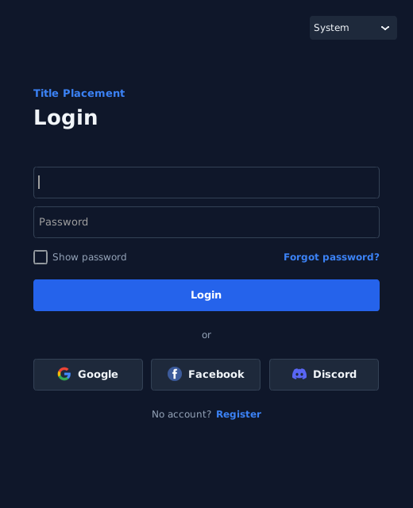
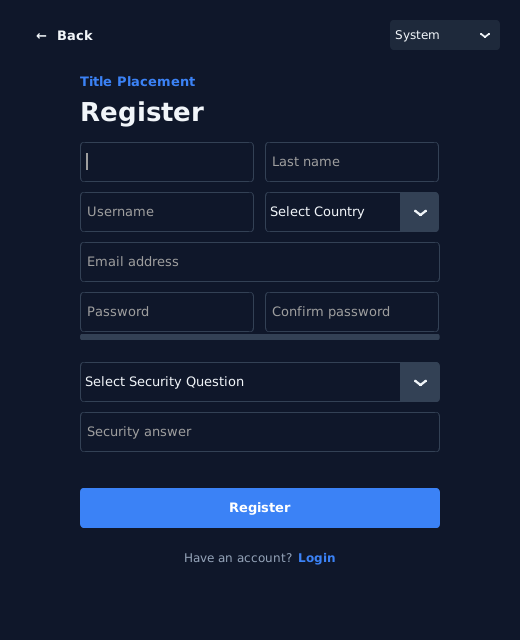
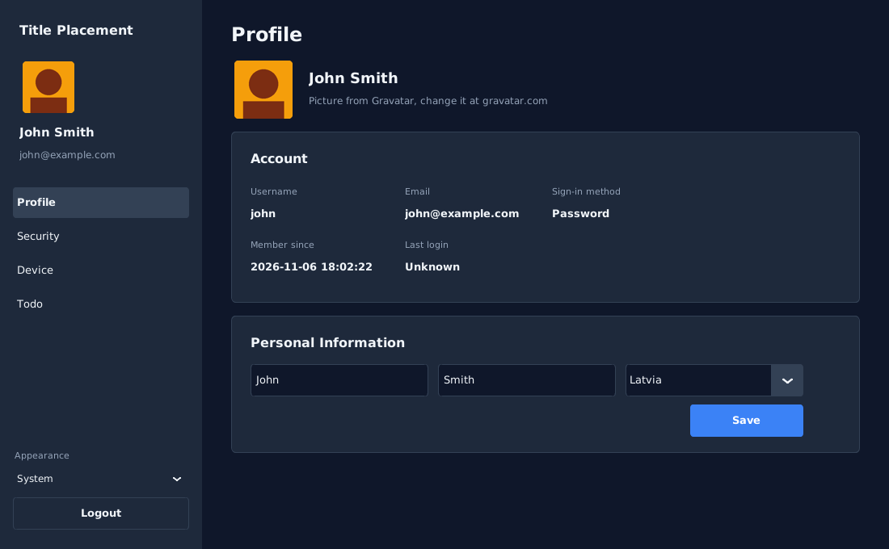
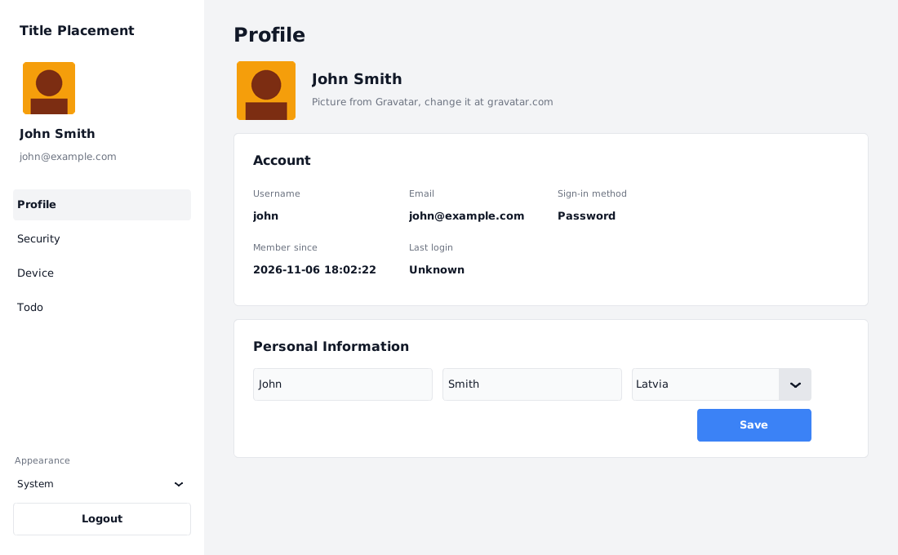
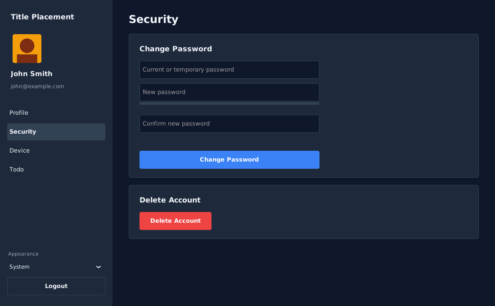
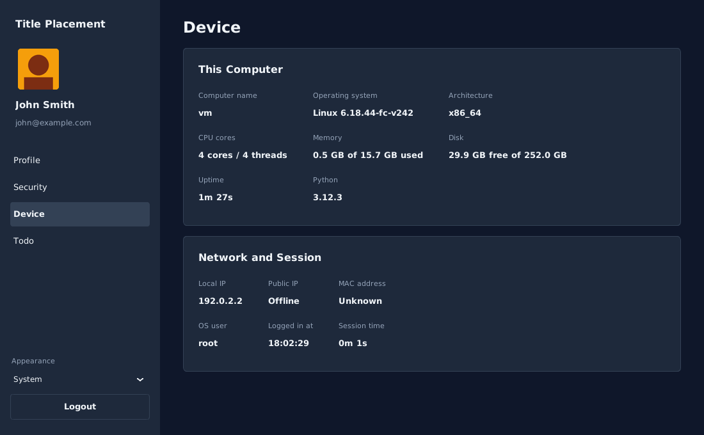
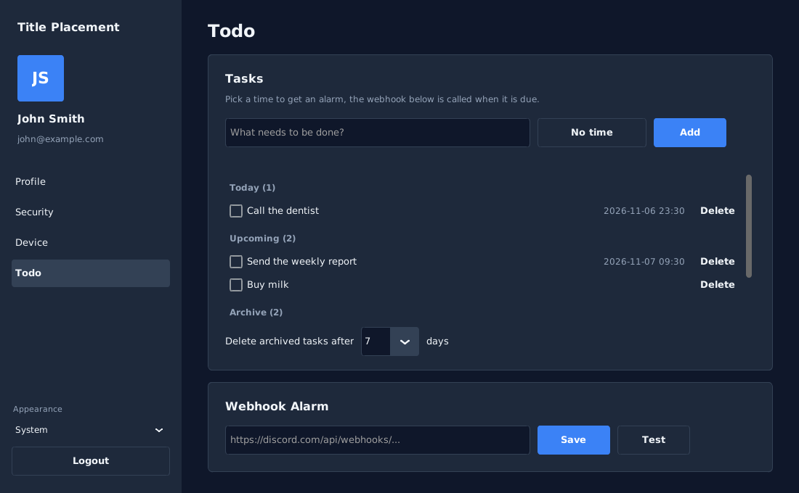
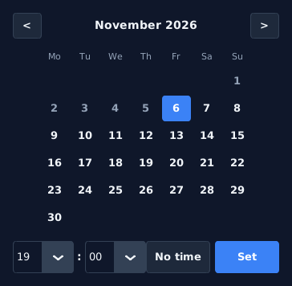

 


# CustomTkinter-Login-Registration

Registration and login app made using customtkinter with input validation, hashed passwords and Google, Facebook and Discord login.

This includes a sqlite3 database setup with many functions including saving the registration data, logging in with username or email, OAuth login, password reset by email, security questions, country selection, light and dark mode, a profile page, password change, account deletion, and more. Settings can be changed in `config.py` or in a `.env` file.

## Table of Contents

- [Screenshots](#screenshots)
- [Prerequisites](#prerequisites)
- [Features](#features)
- [Security](#security)
- [Project Structure](#project-structure)
- [Installation](#installation)
- [Windows Release (.exe)](#windows-release-exe)
- [Database Location](#database-location)
- [PostgreSQL and MySQL](#postgresql-and-mysql)
- [Configuration](#configuration)
- [OAuth Setup](#oauth-setup)
- [Database Functions](#database-functions)
- [User Functions](#user-functions)
- [Device and Todo Functions](#device-and-todo-functions)
- [OAuth Functions](#oauth-functions)
- [Validation Functions](#validation-functions)
- [UI Functions](#ui-functions)
- [Frames](#frames)
- [App and Config](#app-and-config)
- [Upgrading From an Older Version](#upgrading-from-an-older-version)
- [Contributing](#contributing)

## Screenshots

### Login and Register



### Profile



### Security


### Device


### Todo



## Prerequisites

Before you begin, ensure you have met the following requirements:

- `Python 3.9+` with `tkinter`: tkinter ships with Python on Windows and macOS. On Linux install it with `sudo apt install python3-tk`.
- `customtkinter`: You can install customtkinter using `pip install customtkinter`.
- `pycountry`: You can install pycountry using `pip install pycountry`.
- `Pillow`: You can install Pillow using `pip install Pillow`.
- `psutil`: You can install psutil using `pip install psutil`.

OAuth sign-in uses only the Python standard library, no extra packages are needed.

Optional, only for other databases:

- `psycopg2-binary` for PostgreSQL: `pip install psycopg2-binary`
- `PyMySQL` for MySQL / MariaDB: `pip install PyMySQL`

## Features

- Login with username or email.
- Google, Facebook and Discord login (OAuth 2.0).
- Registration with password confirmation and password strength bar.
- Forgot password: email, security question, temporary password sent by email.
- New password required after logging in with a temporary password.
- Profile page: Gravatar profile picture, account details, edit name and country.
- Security page: change or set password, delete account.
- Device page: computer name, OS, CPU, memory, disk, uptime, local and public IP, MAC address, OS user and session time.
- Todo list with Today, Upcoming and Archive. The alarm time is picked from a calendar and sends a message to a Discord, Slack or any other webhook.
- Archived tasks (done or from before today) are deleted after 1, 3, 7, 14 or 30 days, you choose.
- Light and dark mode.
- Settings in `config.py` or `.env`.
- SQLite by default, PostgreSQL or MySQL with one setting.
- Builds for Windows, macOS and Linux with GitHub Actions.
- Older databases are upgraded automatically.

## Security

- Passwords and security answers are hashed with PBKDF2-SHA256 and a random salt.
- Account is locked for 5 minutes after 5 wrong passwords.
- 3 wrong security answers send the user back to the login screen.
- Temporary passwords are made with `secrets` and only saved if the email was sent.
- OAuth uses a random `state` check, PKCE for Google and a local redirect server that closes after a timeout.
- A social login is only linked to an existing account if the provider says the email is verified.
- SMTP and OAuth secrets are kept in `.env`, which is ignored by git.
- All queries use `?` parameters.

## Project Structure

```
main.py           # Start the app
app.py            # MainApp window, switches between frames
frames.py         # All screens and UI helper functions
functions.py      # User, security, email and validation functions
database.py       # Database connection for SQLite, PostgreSQL and MySQL
oauth.py          # Google, Facebook and Discord sign-in (OAuth 2.0)
config.py         # Every setting, reads .env for values you change
.env.example      # Template for your .env file
requirements.txt  # Python packages
build.py          # Builds the one-file .exe with PyInstaller
build.bat         # Windows: double-click to build the .exe
tests/            # Tests, run with: python -m unittest discover -s tests -t .
.github/workflows # Tests and builds on Windows, macOS and Linux
images/           # Login button logos and screenshots
```

## Installation

To install CustomTkinter-Login-Registration, follow these steps:

1. Clone this repository:

   ```bash
   git clone https://github.com/cfunkz/CustomTkinter-Login-Registration.git
   cd CustomTkinter-Login-Registration
   ```

2. Install Imports:

   ```bash
   pip install -r requirements.txt
   ```

3. Create your settings file (optional, only needed for email and OAuth login):

   ```bash
   cp .env.example .env
   ```

4. Run the app:

   ```bash
   python main.py
   ```

## Windows Release (.exe)

The app can be built into one `CustomTkinterApp.exe` file that runs without Python installed.

1. On Windows, install Python 3.9+ from [python.org](https://www.python.org/downloads/).
2. Double-click `build.bat` (or run `python build.py`).
3. The release is `dist\CustomTkinterApp.exe`.

`build.py` uses PyInstaller and bundles the images, customtkinter themes, country list and the PostgreSQL / MySQL driver if it is installed. Add `images\icon.ico` to give the `.exe` an icon. PyInstaller builds for the system it runs on, so build the Windows `.exe` on Windows.

To configure the `.exe`, put a `.env` file next to it or in the data folder below.

On macOS and Linux run `python3 build.py` the same way, it makes `dist/CustomTkinterApp.app` or `dist/CustomTkinterApp`.

GitHub Actions tests and builds all three on every push, download them from the run's Artifacts. Push a tag like `v1.0.0` to add them to a release as `CustomTkinterApp-Windows.exe`, `CustomTkinterApp-macOS.zip` and `CustomTkinterApp-Linux.tar.gz`.

The build is always called `CustomTkinterApp`, `APP_NAME` only changes the title shown in the app.

## Database Location

The SQLite database is saved in one fixed folder per user, so it is the same no matter where the app or `.exe` is started from:

| System | Folder |
| --- | --- |
| Windows | `%APPDATA%\TitlePlacement\user_database.db` |
| macOS | `~/Library/Application Support/TitlePlacement/user_database.db` |
| Linux | `~/.local/share/TitlePlacement/user_database.db` |

Change the folder name with `DATA_FOLDER`, or use another file with `DATABASE_FILE`.

## PostgreSQL and MySQL

SQLite is used by default. To use PostgreSQL or MySQL / MariaDB, install the driver and add the connection to `.env`. The `Users` table is created on first start.

PostgreSQL (`pip install psycopg2-binary`):

```bash
DATABASE_TYPE=postgres
DATABASE_HOST=localhost
DATABASE_PORT=5432
DATABASE_NAME=user_database
DATABASE_USER=app
DATABASE_PASSWORD=your-password
```

MySQL / MariaDB (`pip install PyMySQL`):

```bash
DATABASE_TYPE=mysql
DATABASE_HOST=localhost
DATABASE_PORT=3306
DATABASE_NAME=user_database
DATABASE_USER=app
DATABASE_PASSWORD=your-password
```

The database itself (`user_database`) must exist, the app only creates the table.

## Configuration

All settings live in `config.py`. Each value is read in this order:

1. Environment variables set in your terminal
2. The `.env` file next to `main.py` or the `.exe`
3. The `.env` file in the data folder (see [Database Location](#database-location))
4. The default value in `config.py`

Only add the values you want to change to `.env`. See `.env.example` for the full list.

| Variable | Default | Description |
| --- | --- | --- |
| `APP_NAME` | `Title Placement` | Name shown in the window title, above the forms and in the sidebar |
| `APPEARANCE_MODE` | `System` | `System`, `Light` or `Dark` |
| `COLOR_THEME` | `blue` | customtkinter theme: `blue`, `green`, `dark-blue` or a `.json` path |
| `ACCENT_COLOR` / `ACCENT_HOVER_COLOR` | `#3B82F6` / `#2563EB` | Buttons, links and highlights |
| `DANGER_COLOR` / `SUCCESS_COLOR` | `#EF4444` / `#22C55E` | Error and success colors |
| `FONT_FAMILY` | `Segoe UI` | Font used everywhere |
| `UI_SCALING` | `1.0` | Scale all widgets |
| `AUTH_WINDOW_SIZE` | `520x640` | Login screens window size |
| `DASHBOARD_WINDOW_SIZE` | `1100x680` | Dashboard window size |
| `WINDOW_RESIZABLE` | `false` | Allow resizing the window |
| `DATA_FOLDER` | `TitlePlacement` | Name of the data folder for the database and `.env` |
| `DATABASE_TYPE` | `sqlite` | `sqlite`, `postgres` or `mysql` |
| `DATABASE_FILE` | data folder `user_database.db` | SQLite database file |
| `DATABASE_HOST` / `DATABASE_PORT` | `localhost` / `5432` or `3306` | PostgreSQL / MySQL server |
| `DATABASE_NAME` | `user_database` | PostgreSQL / MySQL database name |
| `DATABASE_USER` / `DATABASE_PASSWORD` | — | PostgreSQL / MySQL login |
| `MIN_PASSWORD_LENGTH` | `8` | Minimum password length |
| `MAX_LOGIN_ATTEMPTS` | `5` | Wrong passwords before lockout |
| `LOCKOUT_MINUTES` | `5` | Lockout length |
| `MAX_SECURITY_ATTEMPTS` | `3` | Wrong security answers allowed |
| `HASH_ITERATIONS` | `310000` | PBKDF2 iterations for new hashes |
| `TEMPORARY_PASSWORD_LENGTH` | `12` | Length of emailed temporary passwords |
| `SMTP_SERVER` / `SMTP_PORT` | `smtp.gmail.com` / `587` | SMTP server (STARTTLS) |
| `SMTP_USERNAME` / `SMTP_PASSWORD` | — | Your Gmail address and [app password](https://myaccount.google.com/apppasswords) |
| `SMTP_TIMEOUT` | `15` | Seconds before an email attempt fails |
| `SENDER_EMAIL` | `SMTP_USERNAME` | The "From" address |
| `OAUTH_PROVIDERS` | `google,facebook,discord` | Social buttons shown, in this order |
| `OAUTH_REDIRECT_HOST` / `PORT` / `PATH` | `localhost` / `8765` / `/callback` | Local redirect URI |
| `OAUTH_TIMEOUT` | `120` | Seconds to wait for the browser sign-in |
| `OAUTH_LINK_BY_EMAIL` | `true` | Link a social sign-in to an existing account with the same verified email |
| `GOOGLE_CLIENT_ID` / `GOOGLE_CLIENT_SECRET` | — | Google OAuth client |
| `FACEBOOK_CLIENT_ID` / `FACEBOOK_CLIENT_SECRET` | — | Facebook app ID and secret |
| `FACEBOOK_API_VERSION` | `v19.0` | Facebook Graph API version |
| `DISCORD_CLIENT_ID` / `DISCORD_CLIENT_SECRET` | — | Discord application |

Example `.env`:

```bash
APP_NAME=Title Placement
APPEARANCE_MODE=Dark
SMTP_USERNAME=you@gmail.com
SMTP_PASSWORD=your-app-password
GOOGLE_CLIENT_ID=1234.apps.googleusercontent.com
GOOGLE_CLIENT_SECRET=your-secret
```

## OAuth Setup

The app opens the provider's login page in the browser and waits for it to redirect back to a small local server. Register this redirect URI with every provider:

```
http://localhost:8765/callback
```

If you change `OAUTH_REDIRECT_HOST`, `OAUTH_REDIRECT_PORT` or `OAUTH_REDIRECT_PATH`, register the new URI instead.

### Google
1. Open [Google Cloud Console > Credentials](https://console.cloud.google.com/apis/credentials).
2. Configure the OAuth consent screen, then create an **OAuth client ID** of type **Desktop app**.
3. Copy the client ID and secret to `GOOGLE_CLIENT_ID` and `GOOGLE_CLIENT_SECRET`.

### Facebook
1. Create an app at [Meta for Developers](https://developers.facebook.com/apps) and add the **Facebook Login** product.
2. Add `http://localhost:8765/callback` to **Valid OAuth Redirect URIs**.
3. Copy the App ID and App Secret to `FACEBOOK_CLIENT_ID` and `FACEBOOK_CLIENT_SECRET`.

### Discord
1. Create an application at the [Discord Developer Portal](https://discord.com/developers/applications).
2. Under **OAuth2 > Redirects** add `http://localhost:8765/callback`.
3. Copy the Client ID and Client Secret to `DISCORD_CLIENT_ID` and `DISCORD_CLIENT_SECRET`.

A provider without a client ID and secret still shows its button, and clicking it explains which values to add. Remove it from `OAUTH_PROVIDERS` to hide it.

## Database Functions

The following functions in `database.py` open the database and create the tables.

### `load_driver()`
- Imports the driver for `DATABASE_TYPE` and explains which package to install if it is missing.

### `get_database_connection()`
- Opens a SQLite, PostgreSQL or MySQL connection (from `DATABASE_TYPE`) and returns the connection and cursor.
- The cursor accepts `?` placeholders on every database.

### `close_database_connection(db)`
- Closes the provided database connection.

### `database()`
- Context manager that opens a connection, commits on success, rolls back on error and always closes it.
- Usage: `with database() as cursor: ...`

### `now()`
- Current time as text, stored the same way on every database.

### `init_database()`
- Creates the `Users` and `Todos` tables once when the app starts.

### `add_missing_columns(cursor, columns, table="Users")`
- Adds columns that an older `Users` or `Todos` table doesn't have (works on SQLite, PostgreSQL and MySQL).

### `upgrade_sqlite_database(cursor)`
- Upgrades an older `user_database.db` with the new columns and case-insensitive indexes.

## User Functions

The following functions in `functions.py` are used for managing users.

### `register_user(first_name, last_name, country, username, email, password, security_question, security_answer)`
- Registers a new user with the provided information. The password and security answer are hashed.
- Returns `True` for successful registration, or `False` if the username or email is already in use.

### `check_login(username, password)`
- Checks the username **or email** and password.
- Returns a tuple `(status, username)` where status is `"ok"`, `"change_password"`, `"locked"` or `"invalid"`.
- Counts failed attempts, locks the account after too many, and upgrades legacy plain-text passwords to hashes.

### `get_lockout_remaining(username)`
- Returns how many seconds are left on an account lockout (`0` if not locked).

### `oauth_login_user(profile)`
- Logs in or registers a user from a social sign-in profile.
- Returns a tuple `(status, username)` where status is `"ok"`, `"linked"` (added to an existing account), `"created"` (new account) or `"email_in_use"`.

### `make_unique_username(base)`
- Turns a name or email into a valid username and adds a number if it is already taken.

### `email_exists(email)`
- Returns `True` if the email address is registered.

### `username_exists(username)`
- Returns `True` if the username is taken.

### `update_password(email, new_password, must_change=False)`
- Saves a new hashed password and clears any lockout.
- `must_change=True` makes the user choose a new password after the next login.
- Returns `True` for a successful password update, or `False` for a failure.

### `reset_password(email)`
- Generates a temporary password, emails it and saves it only if the email was sent.
- Returns `True` on success, or `False` if the email could not be sent.

### `change_password(username, old_password, new_password)`
- Changes a password after checking the current one. Social sign-in accounts without a password can set one directly.
- Returns a tuple `(success, message)`.

### `get_user_data(username)`
- Returns a dictionary of the user's profile, sign-in provider, webhook and whether a password is set, or `None` if not found.

### `update_user_profile(username, first_name, last_name, country)`
- Updates the user's name and country. Returns `True` on success.

### `delete_user(username, confirmation)`
- Deletes an account after confirming the password (or the username for social sign-in accounts without a password).
- Returns `True` on success.

### `get_gravatar(email, size=144)`
- Downloads the user's [Gravatar](https://gravatar.com) picture, found by the SHA-256 hash of the email.
- Returns the picture bytes, or `None` if the user has no Gravatar or there is no internet.
- The result is kept in memory until the app is closed, so it is only downloaded once.

### `get_security_question(email)`
- Retrieves the security question associated with the given email address.
- Returns the security question or `None` if the email is not found or the account uses social sign-in.

### `check_security_answer(email, provided_answer)`
- Checks if the provided security answer matches the stored (hashed) answer, case and space insensitive.
- Returns `True` if the security answer matches, or `False` if it does not.

### `hash_password(password)`
- Hashes a password with PBKDF2-SHA256 and a random salt, stored as `iterations$salt$hash`.

### `verify_password(password, stored_password)`
- Checks a password against a stored hash in constant time. Also accepts legacy plain-text values.

### `is_hashed(stored_password)`
- Returns `True` if a stored value is already a hash.

### `normalize_answer(answer)`
- Lowercases a security answer and collapses extra spaces.

### `generate_temporary_password(length=None)`
- Generates a cryptographically secure temporary password with at least one letter and one digit (length from `TEMPORARY_PASSWORD_LENGTH`).

### `send_password_reset_email(email, temporary_password)`
- Sends a password reset email to the provided email address with the temporary password.
- Returns `True` if the email was sent, or `False` if SMTP is not configured or on any SMTP or network error.

## Device and Todo Functions

The following functions in `functions.py` are used by the Device and Todo pages.

### `get_system_info()`
- Returns the computer name, OS, architecture, CPU cores, memory, disk, uptime, Python version, OS user, local IP and MAC address.

### `get_local_ip()`
- Returns the IP address of this computer on the local network. Nothing is sent, it only picks the network card.

### `get_public_ip()`
- Returns the IP address the internet sees, from api.ipify.org. Slow, so the Device page calls it in the background.

### `get_mac_address()`
- Returns the MAC address of the network card, or `"Unknown"` if it can't be read.

### `get_os_name()`
- Returns a readable OS name like `"Windows 11"`, `"macOS 14.5"` or `"Linux 6.8.0"`.

### `format_size(size)`
- Turns bytes into text like `"15.8 GB"`.

### `format_duration(seconds)`
- Turns seconds into text like `"3h 15m"` or `"5m 42s"`, used for uptime and session time.

### `add_todo(username, text, due_at="")`
- Saves a new task, with an optional due time.

### `get_todos(username)`
- Returns all tasks of a user, sorted by time (tasks without a time last).

### `group_todos(todos)`
- Splits tasks into `Today`, `Upcoming` (later or no time) and `Archive` (done, or from before today).

### `set_todo_done(todo_id, done)`
- Checks or unchecks a task and saves when it was done.

### `delete_old_todos(username, days)`
- Deletes archived tasks that are older than `days`. Done tasks count from when they were done.

### `update_archive_days(username, days)`
- Saves after how many days archived tasks are deleted.

### `delete_todo(todo_id)`
- Deletes a task.

### `get_due_todos(username)`
- Returns open tasks whose time has come and that haven't been sent yet.

### `mark_todo_notified(todo_id)`
- Marks a task as sent so the alarm only goes off once.

### `update_webhook_url(username, url)`
- Saves the user's webhook URL.

### `send_webhook(url, message)`
- Sends a message to a webhook. Works with Discord, Slack or any URL that accepts a JSON POST.
- Returns `True` if the message was sent.

## OAuth Functions

The following functions in `oauth.py` handle social sign-in.

### `oauth_sign_in(provider)`
- Runs the full browser sign-in for `"google"`, `"facebook"` or `"discord"` and returns the user's profile.
- Blocking, the UI runs it in a background thread. Raises `OAuthError` with a message for the user.

### `build_authorization_url(provider, state, code_challenge=None)`
- Builds the URL of the provider's sign-in page.

### `wait_for_callback(expected_state, timeout=None)`
- Starts a local server on `127.0.0.1`, waits for the redirect and returns the authorization code after checking `state`.

### `exchange_code_for_token(provider, code, code_verifier=None)`
- Trades the authorization code for an access token.

### `fetch_user_profile(provider, access_token)`
- Reads the signed in user's profile and converts it to the app's format (`id`, `email`, `email_verified`, `first_name`, `last_name`, `username`, `provider`).

### `parse_google_profile(data)`, `parse_facebook_profile(data)`, `parse_discord_profile(data)`
- Convert each provider's profile into the app's format.

### `http_json(url, data=None, headers=None, method="GET")`
- Sends a request and returns the JSON response.

### `generate_pkce_pair()`
- Creates a PKCE code verifier and its SHA-256 challenge.

### `get_redirect_uri()`
- Returns the redirect URI to register with each provider.

### `get_display_providers()`
- Returns the providers from `OAUTH_PROVIDERS` that the app supports, in the configured order.

### `is_provider_configured(provider)`
- Returns `True` when a provider has a client ID and secret.

### `get_provider_name(provider)`
- Returns the display name of a provider, e.g. `"google"` > `"Google"`.

## Validation Functions

The following functions in `functions.py` check user input.

### `is_valid_email(email)`
- Returns `True` if the email address looks valid.

### `is_valid_chars(input_string)`
- Returns `True` if the text only has letters, numbers, `_` and `-` (used for usernames).

### `is_valid_chars_space(input_string)`
- Same as `is_valid_chars`, but spaces are allowed too (used for names).

### `is_valid_password_chars(input_string)`
- Returns `True` if the password only has printable characters and no spaces.

### `is_strong_password(password, min_length=None)`
- Returns `True` if the password is long enough (`MIN_PASSWORD_LENGTH`) and has both letters and numbers.

### `password_strength(password)`
- Returns a score from 0 to 4, shown by the strength bar.

### `validate_country(country_name)`
- Returns `True` if the country is in the country list.

### `get_countries()` and `get_countries_set()`
- Return the country names sorted alphabetically, and as a set for fast checks (cached after the first call).

### `toggle_password(p_block, show_password_var)`
- Shows or hides the text of a password field.

### `test_buttons()`
- Prints a message, handy to test a new button.

## UI Functions

The following functions in `frames.py` create the widgets, so every screen has the same look.

### `font(size, weight)`
- Shared fonts, created once and reused.

### `load_image(path, size)`
- Loads and caches an image (the login button logos).

### `avatar_image(data, size)`
- Turns the downloaded Gravatar picture into a square image with slightly rounded corners.

### `create_title(master, title, subtitle)`
- Adds a large title with a muted subtitle.

### `create_entry(master, placeholder, show, width)`
- Input field.

### `create_combobox(master, variable, values, width)`
- Read-only dropdown that matches the input fields.

### `create_button(master, text, command, style, width, height, image)`
- Button in `primary`, `secondary`, `danger` or `ghost` style.

### `create_link(master, text, command, size)`
- Clickable text in the accent color.

### `create_status_label(master)` and `show_status(label, text, kind)`
- Show error, success and info messages under the form.

### `create_strength_meter(master)` and `update_strength_meter(meter, password)`
- Bar and label that show password strength while typing.

### `create_appearance_menu(master)`
- Dropdown to switch between System, Light and Dark mode.

### `create_card(master, title, subtitle)`
- Card with a heading. Returns the card and the frame to put content in.

### `run_in_background(widget, task, on_done)`
- Runs slow tasks (email, OAuth, Gravatar, public IP) in a thread so the window doesn't freeze, then calls `on_done(result, error)`.

## Frames

Every screen is a class in `frames.py`.

### `PasswordDialog`
- Input dialog that hides what is typed, used to confirm the password before deleting an account.

### `CalendarPopup(master, on_pick)`
- Small window to pick a day and a time for a todo. Past days are greyed out.
- `change_month(step)` goes to the previous or next month, `select_day(day)` picks a day, `show_month()` draws the days.
- `pick()` calls `on_pick("2024-01-31 18:30")` and closes the window, `clear()` calls `on_pick("")` for no time.

### `AuthFrame`
- Shared layout for every login screen: back button, appearance menu and a centered form.
- `create_footer(text, link_text, command)` adds the "No account? Register" line under the form.

### `ChangePasswordForm`
- Change password fields, used after a password reset and on the Security page.
- `handle_change_password()` checks the fields and saves the new password.

### `MainFrame`
- The login screen.
- `setup_login_frame()` builds the form, `setup_social_buttons(providers)` adds the Google, Facebook and Discord buttons.
- `check_login_credentials()` logs in with username or email.
- `start_oauth_login(provider)` and `finish_oauth_login(result, error)` run the browser sign-in in the background.
- `set_social_buttons_state(state)` enables or disables the social buttons while signing in.

### `RegisterFrame`
- The registration screen.
- `setup_register_frame()` builds the form, `new_user_data()` checks the inputs and saves the user.

### `ForgotPasswordFrame`
- Asks for the email of the account. `handle_reset_password()` checks it and opens the security question.

### `ForgotPasswordFrame2`
- Asks the security question. `handle_reset_password()` checks the answer and emails a temporary password, `finish_reset_password(sent, error)` shows the result.

### `ChangePasswordFrame`
- Shown after logging in with a temporary password, the user has to choose a new one.

### `LoggedInFrame`
- The dashboard with the sidebar and the Profile, Security, Device and Todo pages.
- `setup_loggedin_frame()` builds the dashboard and starts loading the Gravatar picture.
- `setup_sidebar()` adds the avatar, name, menu, appearance menu and logout button.
- `show_gravatar(data, error)` puts the Gravatar picture in the sidebar and on the Profile page.
- `show_page(page)` switches between the pages. `create_page_header(title)` adds the page title.
- `setup_profile_page()` shows the picture, account details and the name and country form. `save_profile()` saves them.
- `create_info_rows(master, rows)` shows label and value pairs in three columns.
- `setup_security_page()` shows the change password form and the delete button. `finish_change_password(message)` shows the result, `handle_delete_account()` asks twice and deletes the account.
- `setup_device_page()` shows the computer info. `update_session_time()` counts the session time every second.
- `setup_todo_page()` shows the task list, the archive setting and the webhook. `show_todos()` deletes old archived tasks and rebuilds the Today, Upcoming and Archive lists, `show_todo_row(todo)` adds one task.
- `open_calendar()` opens the calendar, `set_due_time(text)` shows the picked time on the time button.
- `save_archive_days(days)` saves after how many days archived tasks are deleted.
- `handle_add_todo()`, `toggle_todo(todo_id, done)` and `remove_todo(todo_id)` add, check and delete tasks.
- `save_webhook()` and `test_webhook()` save and test the webhook URL.
- `check_todo_alarms()` checks every 30 seconds for tasks that are due, shows them and sends them to the webhook.

## App and Config

### `MainApp` (`app.py`)
- The main window. `switch_frame(frame_class, *args)` destroys the current frame and shows a new one.
- `open_main_frame()`, `open_register_frame()`, `open_forgot_password_frame()`, `open_forgot_password_frame2(email)`, `open_change_password_frame(username)` and `open_loggedin_frame(username)` open each screen.
- `change_geometry(size)` and `change_title(title)` change the window size and title, `center_window()` moves it to the middle of the screen.
- `destroy_all_frames()` removes the current frame.

### `resource_path(relative_path)` and `get_data_dir(folder_name)` (`config.py`)
- `resource_path` finds bundled files (images) both from source and from the `.exe`.
- `get_data_dir` returns the per-user data folder and creates it if needed.

### `load_env_file(path)` and `get_env()`, `get_env_int()`, `get_env_float()`, `get_env_bool()`, `get_env_list()` (`config.py`)
- Read `.env` and typed settings, falling back to the default when a value is missing or invalid.

## Upgrading From an Older Version

The database now lives in the data folder (see [Database Location](#database-location)). To keep your users, move your old `user_database.db` there, or set `DATABASE_FILE` to its path.

Your existing `user_database.db` keeps working. On start the app adds the new columns, and each user's plain-text password and security answer are replaced with a hash the next time they log in or answer their question.

## Contributing

Contributions are welcome! Please feel free to open an issue or create a pull request.
